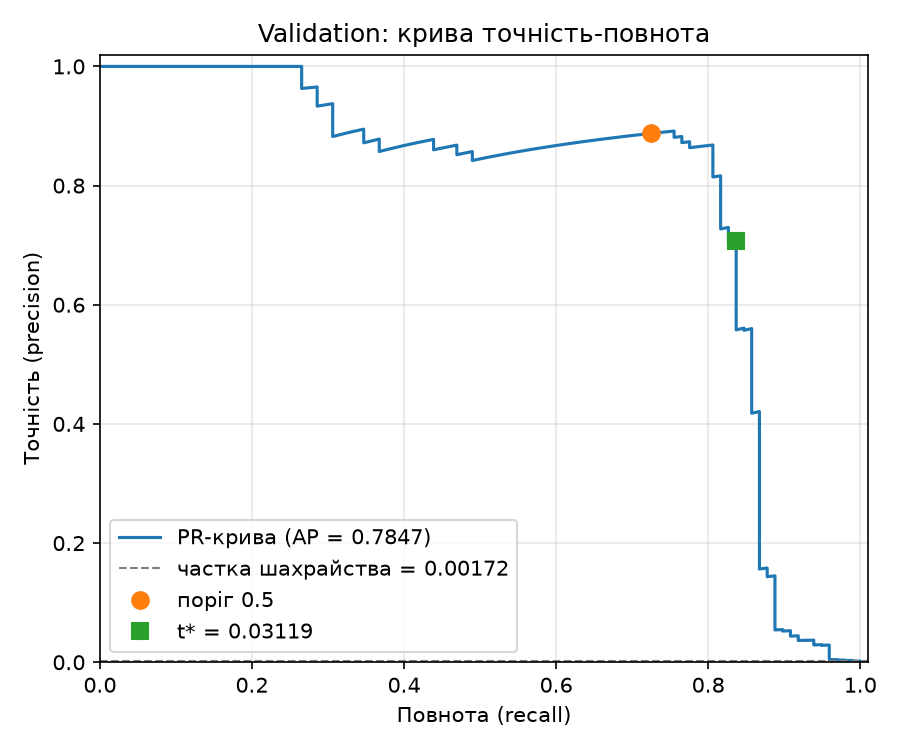
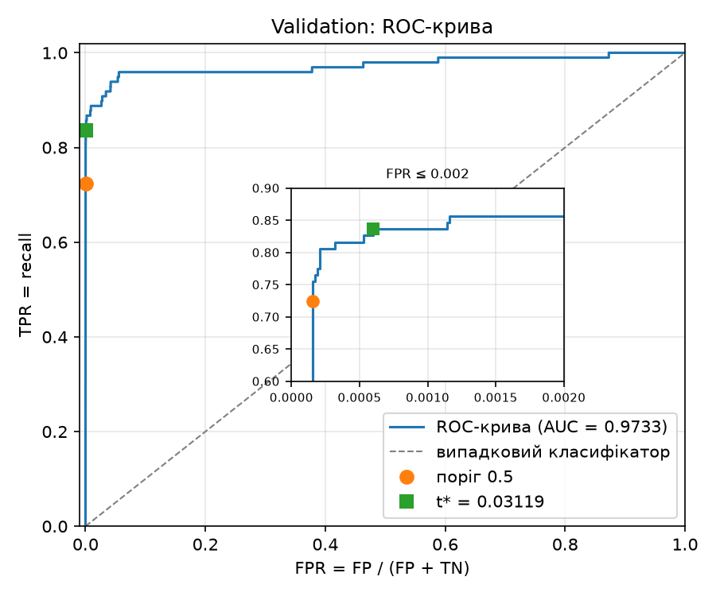

# ЛР2. Поріг рішення під асиметричну ціну помилок

**Автор:** Микитенко Юрій Андрійович, група КМ-32  
**Стек:** Python 3.12, NumPy 2.4.4, pandas 3.0.6, scikit-learn 1.8.0, PyTorch 2.8.0, Matplotlib 3.11.2. Навчання на CPU у `float32`.

## 1. Відтворення

Набір даних: [Credit Card Fraud Detection (Kaggle, mlg-ulb/creditcardfraud)](https://www.kaggle.com/datasets/mlg-ulb/creditcardfraud), файл `creditcard.csv`. CSV до репозиторію не додається: шлях до нього передається параметром `--data`.

```bash
cd lab2
uv sync                  
# 1) навчання з локального CSV (тека --out має бути порожньою або не існувати)
uv run python lab2_starter.py --data /шлях/до/creditcard.csv --out results
# 2) аналіз зі збережених прогнозів, без навчання і без CSV
uv run python analysis.py --saved results --out analysis
```

Тека `results/` уже є в репозиторії, тому для повторного навчання задайте нову теку, наприклад `--out results_rerun`. Друга команда відтворює всі числа цього звіту з `results/predictions.npz`.

**Перевірка відтворюваності.** Повторне навчання в нову теку дало побітово ті самі індекси поділу, мітки, `Amount`, статистики `StandardScaler` і навіть оцінки `s`. Два запуски `analysis.py` дали ідентичні CSV, MD і JSON.

## 2. Структура

| Файл | Призначення |
|---|---|
| `lab2_starter.py` | Стартовий код викладача (без змін): поділ, `StandardScaler`, навчання 12 епох, збереження прогнозів |
| `threshold.py` | `confusion_at` (пряме правило s ≥ t), `cost`, `precision_recall`, швидкий пошук `threshold_table` + `select_threshold` |
| `checks.py` | Незалежний прямий перебір і перевірка на наборах A/B/C |
| `analysis.py` | CLI пунктів 2-4: криві, t\*, перевірки, тест, розбір помилок |
| `pyproject.toml`, `uv.lock` | Залежності із зафіксованими версіями |
| `results/model.pt` | Ваги моделі після 12-ї епохи |
| `results/predictions.npz` | Індекси рядків CSV, мітки, сирі `Amount` для train/validation/test; оцінки s для validation і test (`float32`, без округлення) |
| `results/preprocessing.npz`, `run.json`, `split_summary.csv` | Статистики scaler, параметри запуску й версії, розміри поділу |
| `analysis/pr_curve_validation.png`, `analysis/roc_curve_validation.png` | Криві на validation |
| `analysis/threshold_candidates_validation.csv` | Повна таблиця кандидатів (55 989 рядків): `threshold, TP, FP, FN, TN, C` |
| `analysis/threshold.json` | Зафіксований поріг t\* і його показники на validation |
| `analysis/checks.md` | Таблиці перевірки на наборах A/B/C |
| `analysis/test_errors.csv`, `analysis/summary.md` | Тестова оцінка, розібрані помилки, зведення |

## 3. Дані та поділ

Ознаки: `V1`–`V28` і `Amount` (29 ознак). `Time` і `Class` до входу моделі не потрапляють. Сирий `Amount` зберігається окремо для аналізу помилок.

Поділ індексів рядків CSV (рядки нумеруються від 0, без заголовка):

1. `train_test_split(idx, test_size=0.4, stratify=Class, random_state=0)` → train (60 %) і відкладена частина (40 %).
2. `train_test_split(idx_tmp, test_size=0.5, stratify=Class[idx_tmp], random_state=0)` → validation (перша частина) і test (друга).

| Вибірка | Об'єктів | Шахрайських | Частка шахрайства |
|---|---|---|---|
| train | 170 884 | 295 | 0.001726 |
| validation | 56 961 | 98 | 0.001720 |
| test | 56 962 | 99 | 0.001738 |
| **разом** | **284 807** | **492** | 0.001727 |

Класи не балансувалися. Стратифікація зберегла частку шахрайства ≈ 0.17 % у кожній вибірці.

**Стандартизація.** Кожна ознака перетворюється за формулою

$$
x' = \frac{x - \mu}{\sigma},
$$

де $\mu$ і $\sigma$ (середнє та стандартне відхилення ознаки) обчислено `StandardScaler` **лише на train** і застосовано до validation і test. Обчислювати їх на всьому наборі не можна, бо тоді в підготовку даних потрапить інформація з validation і test (data leakage). Модель і поріг формально вибиралися б без цих об'єктів, але перетворення вже «бачило» б їхній розподіл, зокрема важкі хвости `Amount` і викиди. Оцінка на test перестала б імітувати нові, ще не бачені транзакції й стала б оптимістично зміщеною. У реальному застосуванні статистики майбутніх даних теж невідомі.

## 4. Модель і навчання

`Linear(29, 32) → ReLU → Linear(32, 1)`, `BCEWithLogitsLoss` (середнє за пакетом, без ваг класів), Adam з lr = 1e-3, 12 епох, пакет 1024 (останній неповний пакет не відкидається). `torch.manual_seed(0)` перед створенням моделі, перемішування train через окремий `np.random.default_rng(0)` з новою перестановкою на кожній епосі. Використано ваги після 12-ї епохи: епоха за validation не вибиралась. BCE на train: 0.3653 після 1-ї епохи, 0.003383 після 12-ї.

Оцінки: модель у `eval()`, `torch.no_grad()`, `s_i = sigmoid(z_i)`, де z_i — логіт.

## 5. Метрики та вартість

Правило рішення: шахрайство, якщо $s_i \ge t$.

Лічильники ($\lvert\cdot\rvert$ — кількість елементів множини):

$$
\begin{aligned}
TP(t) &= \bigl\lvert\{\, i : s_i \ge t,\ y_i = 1 \,\}\bigr\rvert, &
FP(t) &= \bigl\lvert\{\, i : s_i \ge t,\ y_i = 0 \,\}\bigr\rvert, \\
FN(t) &= \bigl\lvert\{\, i : s_i < t,\ y_i = 1 \,\}\bigr\rvert, &
TN(t) &= \bigl\lvert\{\, i : s_i < t,\ y_i = 0 \,\}\bigr\rvert.
\end{aligned}
$$

Вартість помилок ($FN$ — пропущене шахрайство, $FP$ — хибна тривога; $\text{Amount}$ у формулу не входить):

$$
C(t) = 10\,FN(t) + FP(t)
$$

Метрики якості:

$$
\mathrm{precision} = \frac{TP}{TP + FP}, \qquad
\mathrm{recall} = \frac{TP}{TP + FN}
$$

Якщо знаменник дорівнює 0, метрика **не визначена** (у коді `None`). Precision не визначена, коли модель не робить жодного позитивного прогнозу (TP + FP = 0, наприклад t = +∞): частку правильних серед позитивних прогнозів неможливо обчислити, бо позитивних прогнозів немає. Recall не визначена, коли у вибірці немає жодного шахрайства (TP + FN = 0, як у наборі B).

## 6. Пошук порога (`threshold.py`)

**Кандидати:** усі унікальні оцінки validation і +∞. Цього достатньо. Між двома сусідніми унікальними оцінками прогнози не змінюються, тому будь-який проміжний поріг дає ту саму матрицю плутанини, що й найближча більша унікальна оцінка. Поріг +∞ означає «усі негативні». Найменша оцінка означає «усі позитивні»: поріг нижче від неї дав би те саме.

**Алгоритм за O(n log n):**

1. `order = argsort(−s)` (стабільне сортування за спаданням) — O(n log n).
2. `tp_cum = cumsum(y_sorted == 1)`, `fp_cum = cumsum(y_sorted == 0)` — O(n).
3. Для порога t = u (унікальна оцінка) позитивні всі об'єкти з s ≥ u, тобто префікс відсортованого масиву **до останнього елемента групи рівних оцінок включно**. Тому TP і FP беруться з кумулятивних сум у позиціях `group_end` (останній індекс кожної групи рівних s). Так рівні оцінки гарантовано отримують однаковий прогноз: група ніколи не розрізається порогом.
4. Перед таблицею додається рядок t = +∞ з TP = FP = 0. Далі `FN = P − TP`, `TN = N − FP`, `C = 10·FN + FP` — векторно, O(n).

Повторного проходу по вибірці для кожного порога немає. На validation 56 961 об'єкт і 55 988 унікальних оцінок: 973 оцінки повторюються через насичення `float32` поблизу 0 і 1, тож обробка рівних оцінок тут суттєва. Разом із +∞ це 55 989 кандидатів.

**Вибір t\*:** мінімум C. Якщо мінімум досягається на кількох порогах, береться **найбільший** з них: за однакової вартості він дає менше тривог, тобто консервативніше рішення.

**Межові випадки:** +∞ є кандидатом, тому «нічого не позначати» завжди порівнюється з іншими правилами. Це обрано, наприклад, у наборі B, де шахрайства немає.

Додатково (поза вимогами) 300 випадкових рядків таблиці validation звірено з прямим `confusion_at`: розбіжностей 0. Для t\* збіг із прямим правилом перевіряється `assert` в `analysis.py`.

## 7. Вибір порога на validation




**ROC-AUC = 0.9733**, average precision (площа під PR) = 0.7847.

| Правило на validation | Поріг | TP | FP | FN | TN | C | Precision | Recall |
|---|---|---|---|---|---|---|---|---|
| Стандартний поріг | 0.5 | 71 | 9 | 27 | 56 854 | 279 | 0.8875 | 0.7245 |
| Мінімум вартості | **t\* = 0.0311939** | 82 | 34 | 16 | 56 829 | **194** | 0.7069 | 0.8367 |
| Усі негативні | +∞ | 0 | 0 | 98 | 56 863 | 980 | не визначено | 0.0000 |

Точне значення порога: t\* = `0.031193923205137253` (значення `float32` оцінки, без округлення; `analysis/threshold.json`). Мінімум C = 194 досягається на одному порозі.

**Чому висока ROC-AUC не гарантує малої вартості чи високої precision.**

- ROC-AUC усереднює якість ранжування за **всіма** порогами й нечутлива до дисбалансу класів, бо FPR нормується на кількість негативних. Вартість і precision залежать від **одного** робочого порога та від абсолютних кількостей.
- Негативних тут у 580 разів більше, ніж позитивних (56 863 проти 98). FPR = 0.001, яка на ROC-кривій виглядає як «майже нуль», означає ≈ 57 хибних тривог. Це більше половини всіх шахрайських транзакцій validation, і precision за такого FPR не може перевищити ≈ 98 / (98 + 57) ≈ 0.63.
- Понад 99 % площі AUC припадає на FPR > 0.01 (ділянка FPR ≤ 0.01 дає не більше 0.01 площі). Там FP обчислюються сотнями й тисячами, тобто це зона, непридатна для роботи. Навпаки, у робочій зоні FPR ≤ 0.002 (вставка на ROC-графіку) різниця між порогами 0.5 і t\* майже невидима, але змінює C на 85.
- AUC не знає про асиметрію ціни 10 : 1, тож дві моделі з однаковою AUC можуть мати різну мінімальну вартість. PR-крива показує це краще: precision різко падає вже після recall ≈ 0.84.

## 8. Перевірка пошуку порога на малих наборах (`checks.py`)

Перевірочна реалізація повністю незалежна від швидкої. Кандидати будуються як `[+inf] + sorted(set(s), reverse=True)`, для кожного кандидата окремо в циклі проходиться вся вибірка за правилом s ≥ t, а t\* вибирається власним циклом (менша C або рівна C і більший t). Результати швидкого алгоритму для неї не використовуються. Порівняння: `DataFrame.equals` для всієї таблиці (поріг, TP, FP, FN, TN, C; збіг точний, разом із типами) і рівність вибраних порогів. Повні таблиці: [`analysis/checks.md`](analysis/checks.md).

**Набір A:** s = [0.9, 0.7, 0.7, 0.4, 0.2, 0.1], y = [0, 1, 0, 1, 0, 0]

| t | TP | FP | FN | TN | C |
|---|---|---|---|---|---|
| +∞ | 0 | 0 | 2 | 4 | 20 |
| 0.9 | 0 | 1 | 2 | 3 | 21 |
| 0.7 | 1 | 2 | 1 | 2 | 12 |
| **0.4** | 2 | 2 | 0 | 2 | **2** |
| 0.2 | 2 | 3 | 0 | 1 | 3 |
| 0.1 | 2 | 4 | 0 | 0 | 4 |

t\* = 0.4 (обидві реалізації). Збіг таблиць: так.

**Набір B:** s = [0.9, 0.6, 0.3], y = [0, 0, 0]

| t | TP | FP | FN | TN | C |
|---|---|---|---|---|---|
| **+∞** | 0 | 0 | 0 | 3 | **0** |
| 0.9 | 0 | 1 | 0 | 2 | 1 |
| 0.6 | 0 | 2 | 0 | 1 | 2 |
| 0.3 | 0 | 3 | 0 | 0 | 3 |

t\* = +∞ (обидві реалізації). Збіг таблиць: так.

**Набір C:** s = [0.8, 0.5 × 11, 0.2], y = [1, 1, 0 × 10, 0]

| t | TP | FP | FN | TN | C |
|---|---|---|---|---|---|
| +∞ | 0 | 0 | 2 | 11 | 20 |
| **0.8** | 1 | 0 | 1 | 11 | **10** |
| 0.5 | 2 | 10 | 0 | 1 | **10** |
| 0.2 | 2 | 11 | 0 | 0 | 11 |

t\* = 0.8 (обидві реалізації). Збіг таблиць: так.

**Що перевіряє кожен набір:**

- **A, рівні оцінки 0.7 з різними мітками (1 і 0).** Обидва об'єкти мають отримати однаковий прогноз, тож для t = 0.7 одночасно TP = 1 і FP = 2. Неправильна реалізація, що бере кумулятивну суму всередині групи, дала б «проміжний» поріг із TP = 1, FP = 1 (C = 11), якого правило s ≥ t не допускає. Крім того, кандидатів 6, а не 7: рівні оцінки дають один кандидат.
- **B, немає позитивних міток.** P = 0, тому FN = 0 за будь-якого порога, а C = FP зростає зі зниженням t. Мінімум C = 0 досягається лише на +∞, тож перевіряється, що +∞ входить до кандидатів і коректно обробляється («усі негативні»), а ділення на P ніде не відбувається. Recall тут не визначена (TP + FN = 0).
- **C, два кандидати з однаковою вартістю.** C(0.8) = C(0.5) = 10: один пропуск (10·1) проти десяти хибних тривог (10·1). Перевіряється правило нічиєї: обирається більший поріг 0.8. Група з 11 рівних оцінок 0.5 з мітками «1 і десять 0» додатково перевіряє, що група не розрізається.

Усі три перевірки пройдено. Лише після цього `analysis.py` переходить до test: за невдалої перевірки скрипт завершується без тестової оцінки.

## 9. Тестова оцінка (t\* зафіксовано на validation)

| Правило на test | Поріг | TP | FP | FN | TN | C | Precision | Recall |
|---|---|---|---|---|---|---|---|---|
| **t\* з validation** | 0.0311939 | 80 | 43 | 19 | 56 820 | **233** | **0.6504** | **0.8081** |
| довідково: 0.5 | 0.5 | 71 | 8 | 28 | 56 855 | 288 | 0.8987 | 0.7172 |
| довідково: усі негативні | +∞ | 0 | 0 | 99 | 56 863 | 990 | не визначено | 0.0000 |

Матриця плутанини на test за t\*:

|  | прогноз: шахрайство | прогноз: легітимна |
|---|---|---|
| **факт: шахрайство (99)** | TP = 80 | FN = 19 |
| **факт: легітимна (56 863)** | FP = 43 | TN = 56 820 |

Рядки «довідково» наведено лише для висновків. Результати test не використовувались для зміни порога, моделі чи налаштувань.

### Розбір помилок на test (перші 5 FP і перші 5 FN за номером рядка CSV)

| Рядок CSV (від 0, без заголовка) | Тип помилки | Мітка | Оцінка s | Amount | s − t\* |
|---|---|---|---|---|---|
| 460 | FP | 0 | 0.196159 | 2.00 | +0.1650 |
| 2961 | FP | 0 | 0.080961 | 2.49 | +0.0498 |
| 10783 | FP | 0 | 0.966327 | 89.99 | +0.9351 |
| 13405 | FP | 0 | 0.932032 | 89.99 | +0.9008 |
| 13617 | FP | 0 | 0.922762 | 89.99 | +0.8916 |
| 10497 | FN | 1 | 0.011464 | 3.79 | −0.0197 |
| 52521 | FN | 1 | 0.006373 | 105.99 | −0.0248 |
| 55401 | FN | 1 | 0.005642 | 1.00 | −0.0256 |
| 91671 | FN | 1 | 0.000500 | 290.18 | −0.0307 |
| 93486 | FN | 1 | 0.018352 | 0.00 | −0.0128 |

Повні значення: `analysis/test_errors.csv`.

**Amount і відстань до порога.**

- **FP:** суми малі або середні (2.00, 2.49 і тричі 89.99). Три з п'яти FP мають s > 0.92: модель упевнено помиляється, і такі помилки не виправити зміною порога в розумних межах. Ще дві (0.08 і 0.20) лежать недалеко від t\*.
- **FN:** суми від 0.00 до 290.18, тобто ширший діапазон, ніж у FP. Усі FN мають s < 0.02. В абсолютних одиницях вони близько до порога (|s − t\*| ≤ 0.031), але лише тому, що сам t\* ≈ 0.03 малий. У логітах відстань суттєва: logit(t\*) ≈ −3.44, а для рядка 91671 logit(s) ≈ −7.60. Модель для цих шахрайських транзакцій майже впевнена, що вони легітимні.
- Довідково по всіх помилках test: медіана Amount для 43 FP = 2.49, для 19 FN = 33.76, для 80 TP = 8.26. Медіана відстані до t\*: FP 0.025, FN 0.029, TP 0.82. Більшість помилок, на відміну від правильних TP, зосереджена поблизу порога.

**Чи можна за десятьма прикладами судити про причину помилок? Ні.**

- Вибірка мала (5 + 5).
- Вона не випадкова: «перші за номером рядка» в цьому CSV означає найраніші за часом транзакції.
- Повтор 89.99 у трьох FP може бути збігом або ознакою одного типу операцій, але без порівняння з правильно класифікованими транзакціями з такою самою сумою висновку не зробити.
- `Amount` — лише одна з 29 ознак, а V1–V28 є анонімізованими PCA-компонентами, тому змістовну причину за ними не встановити.
- Для висновків потрібні всі помилки, розподіли ознак у FP/FN/TP/TN і статистичне порівняння. Десять прикладів годяться лише для формулювання гіпотез.

## 10. Висновки

1. **Що змінив вибір порога.** Модель і її оцінки s не змінювались, змінилося лише правило s ≥ t. Зниження порога з 0.5 до t\* ≈ 0.0312 зробило модель чутливішою. На validation C знизилася з 279 до 194 (−30 %), recall зросла з 0.72 до 0.84.
2. **Ціна рішення в термінах FP і FN.** На validation: −11 FN (27 → 16) коштом +25 FP (9 → 34). Виграш у вартості 10·11 − 25 = 85, precision знизилася з 0.89 до 0.71. На test за того самого t\*: −9 FN (28 → 19) коштом +35 FP (8 → 43), C 288 → 233, тобто виграш лише 55, а precision знизилася з 0.90 до 0.65. Кожен «врятований» випадок шахрайства коштує кількох хибних тривог, і це вигідно лише тому, що пропуск у 10 разів дорожчий.
3. **Чому validation не гарантує такого самого виграшу на test.**
   - t\* — точка мінімуму, обрана по тій самій validation, на якій оцінено C = 194. Ця оцінка оптимістично зміщена, бо поріг підігнано під конкретну вибірку.
   - Позитивних об'єктів лише 98 і 99: один FN змінює C на 10, тож вартість має велику дисперсію. На test біля порога опинилися інші конкретні транзакції.
   - Мінімум C(t) гострий і крихкий: t\* = 0.031194 збігається з оцінкою одного шахрайського об'єкта validation. Сусідній поріг 0.031203, вищий лише на 1e-5, уже дає C = 204, а 11 порогів мають C ≤ 200. Точна позиція мінімуму залежить від кількох конкретних транзакцій і на іншій вибірці не переноситься.
   - На test та сама процедура дала менший виграш (55 замість 85) і нижчу precision, хоча напрям ефекту зберігся: за t\* вартість усе одно нижча, ніж за 0.5.
4. Швидкий пошук за O(n log n) точно збігся з незалежним прямим перебором на наборах A/B/C, зокрема в обробці рівних оцінок, порога +∞ і нічиєї за вартістю.

## 11. Джерела та використані інструменти

- Стартовий код `lab2_starter.py` надав викладач. Він використаний без змін.
- Документація scikit-learn (`train_test_split`, `StandardScaler`, `precision_recall_curve`, `roc_curve`, `roc_auc_score`), PyTorch, NumPy, pandas, Matplotlib.
- Під час виконання використано генеративний інструмент Claude (Anthropic) для підготовки коду аналізу та тексту звіту. Код, формули й результати перевірок автор перевірив і пояснює самостійно.
