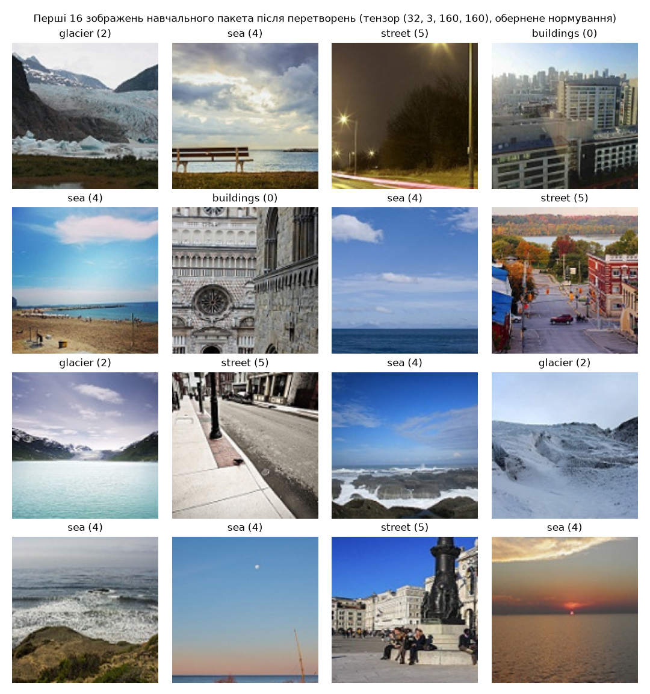
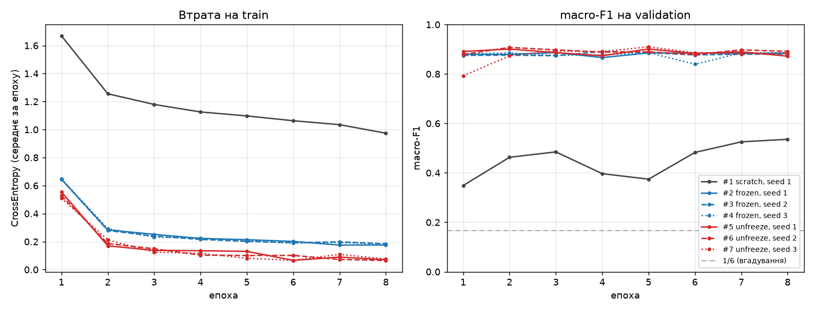
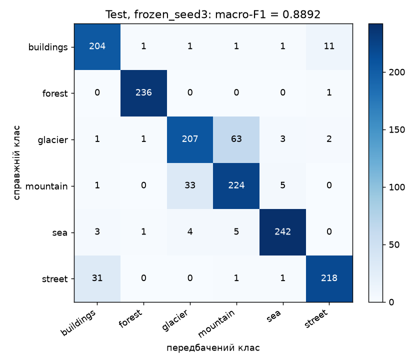
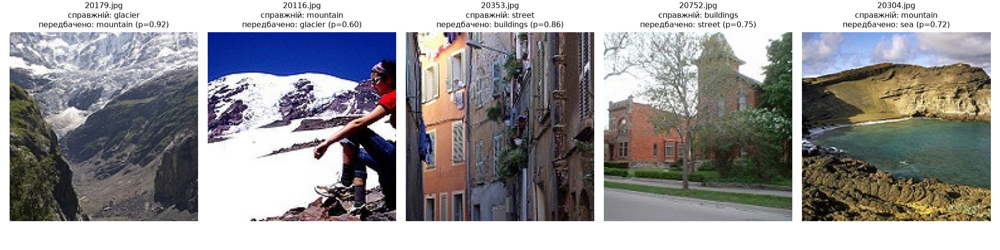

# ЛР3. Обчислювальний експеримент і трансферне навчання

**Автор:** Микитенко Юрій Андрійович, група КМ-32  
**Стек:** Python 3.12, PyTorch 2.8.0, torchvision 0.23.0, NumPy 2.4.4, scikit-learn 1.8.0, Matplotlib 3.11.2, Pillow 13.0.0. Навчання у `float32` на MPS (Apple M4 Pro), тестова оцінка на CPU.

**Питання роботи.** Яку частину виграшу ResNet-18 на малій вибірці (200 зображень на клас) дають попередньо навчені ознаки, яку — донавчання кістяка, і чи більша кожна з цих різниць за розкид між запусками?

## 1. Відтворення

Набір: [Intel Image Classification (Kaggle, puneet6060/intel-image-classification)](https://www.kaggle.com/datasets/puneet6060/intel-image-classification). Параметр `--data` — тека розпакованого архіву, у якій лежать `seg_train/seg_train/<клас>/` і `seg_test/seg_test/<клас>/`. Набір до репозиторію не додається.

```bash
cd lab3
uv sync
```

```bash
uv run python train.py --data /шлях/до/archive
```

```bash
uv run python analyze.py --data /шлях/до/archive
```

| Команда | Що робить | Що пише |
|---|---|---|
| `train.py` (навчання) | поділ і його контроль, перевірки пунктів 1–2, сім запусків, вибір за validation, `lab3_model.pt`. **Test не завантажується** | `split.csv`, `checks/`, `figures/train_batch.png`, `runs/*/run.json`, `runs/*/val_logits.npy`, `lab3_model.pt` |
| `analyze.py` (аналіз) | перевірка SHA-256 `split.csv` у семи журналах; таблиця, криві, ефекти й перевірка вибору — лише з журналів; потім одноразова оцінка `lab3_model.pt` на test на CPU | `analysis/summary.md`, `analysis/summary.json`, `analysis/test_logits.npy`, `figures/curves.png`, `figures/confusion_test.png`, `figures/five_errors.png` |

`train.py` перезаписує `split.csv`, `runs/` і `lab3_model.pt` у теці `lab3/`. Щоб не зачепити збережені результати, повторне навчання варто запускати в іншу теку: `--out rerun` (аналіз тоді: `--root rerun`). Опція `--checks-only` виконує лише пункти 1–2 (≈ 30 с).

Усі числа розділів 8–11 цього звіту взято з виводу `analyze.py` (`analysis/summary.md`).

## 2. Структура

| Файл | Призначення |
|---|---|
| `common.py` | Константи завдання, поділ, `ImageDataset`, перетворення, побудова моделі (кроки 1–5), `set_train_mode`, цикл навчання, macro-F1, журнал, правило вибору |
| `train.py` | Команда навчання: пункти 1–3 і вибір пункту 5 |
| `analyze.py` | Команда аналізу: пункти 3–5 зі збережених журналів і тестова оцінка |
| `pyproject.toml`, `uv.lock`, `.python-version` | Залежності із зафіксованими версіями |
| `split.csv` | Поділ: `file, label, part` (4200 рядків) |
| `checks/checks.md`, `checks/checks.json` | Результати перевірок пунктів 1–2 |
| `runs/<режим>_seed<зерно>/` | `run.json` (журнал) і `val_logits.npy` ($1498 \times 6$) для семи запусків. Ваги `model.pt` лишаються локально (`.gitignore`) |
| `lab3_model.pt` | Ваги вибраного запуску: `state_dict`, `regime`, `seed`, `classes`, `img_size` |
| `figures/` | Пакет після перетворень, криві, матриця плутанини, п'ять помилок |
| `analysis/` | Підсумки команди аналізу |
| `train_log.txt` | Повний вивід команди навчання, з якого отримано журнали |
| `analysis_log.txt` | Повний вивід команди аналізу |

## 3. Дані та поділ

Класи у фіксованому порядку: `buildings, forest, glacier, mountain, sea, street` (індекси $0\ldots5$). Зображення відкриваються через `PIL.Image.open(...).convert("RGB")`; 55 зображень меншої висоти не відкидаються, розмір вирівнюють перетворення. Тека `seg_pred` не використовується.

Процедура поділу (`common.make_split`):

1. Для кожного класу — список імен файлів, відсортований як рядки (`sorted()`).
2. **train:** один `rng = np.random.default_rng(0)` на всі класи по черзі; для класу $k$ з $n_k$ файлами в `seg_train`: `idx = np.arange(n_k)`, `rng.shuffle(idx)`, у train — `idx[:200]`. Разом $6 \cdot 200 = 1200$.
3. **validation / test:** новий `default_rng(0)` на всі класи `seg_test` по черзі: `rng.shuffle(idx)`, $\text{cut} = \lfloor n_k/2 \rfloor$; `idx[:cut]` — validation, `idx[cut:]` — test.

`split.csv` (стовпці `file, label, part`) упорядковано за частиною, класом та іменем файлу. Далі всі дані завантажуються **лише** за цим файлом; `ImageDataset` зберігає порядок рядків, тож `val_logits.npy` і `test_logits.npy` вирівняні з `split.csv`. Декодовані зображення кешуються в пам'яті (лише прискорення: випадкові перетворення застосовуються заново при кожному зверненні).

## 4. Перетворення, модель і режими

| Частина | Перетворення (`torchvision.transforms`, решта параметрів за замовчуванням) |
|---|---|
| train | `RandomResizedCrop(160, scale=(0.7, 1.0))` (ratio $= (3/4,\,4/3)$, bilinear, antialias) → `RandomHorizontalFlip()` ($p=0.5$) → `ToTensor()` → `Normalize(mean, std)` |
| validation, test | `Resize((160, 160))` → `ToTensor()` → `Normalize(mean, std)` |

$\text{mean} = (0.485,\ 0.456,\ 0.406)$, $\text{std} = (0.229,\ 0.224,\ 0.225)$ — статистики ImageNet, однакові для всіх трьох режимів:

$$
x' = \frac{x - \text{mean}_c}{\text{std}_c}, \qquad c \in \{R, G, B\}.
$$

**Побудова моделі** (`common.build`): (1) `torch.manual_seed(seed)`, `np.random.seed(seed)`; (2) `resnet18(weights=W)`, $W$ = `None` для scratch і `IMAGENET1K_V1` для frozen/unfreeze; (3) `model.fc = Linear(512, 6)` зі стандартною ініціалізацією; (4) `requires_grad=False` для всіх параметрів поза стовпцем «Що навчається»; (5) `.to(device)` і `AdamW(weight_decay=1e-4)`, у який передаються лише параметри, що навчаються.

| Режим | Ваги | Що навчається | Параметрів, що навчаються | Групи AdamW | У `eval()` під час навчання |
|---|---|---|---|---|---|
| scratch | випадкові | уся мережа | 11 179 590 | усі, $3\cdot10^{-3}$ | — |
| frozen | ImageNet | `fc` | 3 078 | `fc`, $3\cdot10^{-3}$ | `conv1, bn1, layer1–layer4` |
| unfreeze | ImageNet | `layer4, fc` | 8 396 806 | `fc`, $3\cdot10^{-3}$; `layer4`, $3\cdot10^{-4}$ | `conv1, bn1, layer1–layer3` |

`set_train_mode(model, regime)` викликає `model.train()`, а потім `.eval()` для кожного модуля зі стовпця «У `eval()`». Кістяку в unfreeze дається менша швидкість навчання ($3\cdot10^{-4}$ проти $3\cdot10^{-3}$ у голови), щоб у перші кроки, поки голова ще випадкова і градієнти великі та шумні, не зруйнувати попередньо навчені ознаки `layer4`. Їх треба лише підлаштувати під нову задачу, а не вчити заново.

**Цикл навчання** (`common.train_run`). Train: `batch_size=32, shuffle=True, drop_last=False, num_workers=0`, без власного генератора (перемішування бере випадковість із глобального генератора PyTorch, засіяного на кроці 1). Validation/test: `batch_size=64, shuffle=False`. Бюджет — 8 епох по $\lceil 1200/32 \rceil = 38$ кроків, разом 304 кроки оптимізатора; останній пакет епохи містить 16 зображень (перевіряється `assert` і записано в журнал). Без розкладу швидкості, обрізання градієнта, змішаної точності, згладжування міток, ваг класів, ранньої зупинки чи вибору епохи. Використовуються ваги після 8-ї епохи.

Втрата пакета — середня крос-ентропія, втрата епохи — середнє за всіма 1200 об'єктами (втрата пакета $b$ до кроку оптимізатора):

$$
L_b = -\frac{1}{|b|}\sum_{i\in b} \log \frac{e^{z_{i,y_i}}}{\sum_{j=0}^{5} e^{z_{ij}}}, \qquad
L_{\text{epoch}} = \frac{1}{1200}\sum_{b} L_b\,|b|.
$$

Після кожної епохи — `model.eval()`, `torch.no_grad()`, логіти validation і macro-F1 (`sklearn.metrics.f1_score(average="macro")`):

$$
\mathrm{F1}_k = \frac{2\,TP_k}{2\,TP_k + FP_k + FN_k}, \qquad
\text{macro-F1} = \frac{1}{6}\sum_{k=0}^{5} \mathrm{F1}_k,
$$

де $TP_k, FP_k, FN_k$ рахуються для класу $k$ проти решти. Підсумок запуску $F_{r,s}$ — macro-F1 на validation після 8-ї епохи для режиму $r$ і зерна $s$.

**Журнал запуску** `runs/<режим>_seed<зерно>/run.json` містить зерно, усі налаштування перетворень, моделі, оптимізатора (з `param_groups` самого `AdamW`, тобто й зі значеннями за замовчуванням: `betas`, `eps`, `amsgrad` тощо) і циклу навчання; хеш коміту й ознаку незакомічених змін; SHA-256 `split.csv`; версії Python, PyTorch, torchvision, NumPy і назву пристрою; втрату train і macro-F1 validation за кожну епоху; час навчання в секундах.

## 5. Перевірки до навчання (пункт 1)

Повні таблиці: [`checks/checks.md`](checks/checks.md).

### Поділ

Кількість зображень / сума числових імен файлів (`20057.jpg` → $20057$) для `split.csv`:

| Клас | train | validation | test |
|---|---|---|---|
| buildings | 200 / 1 996 761 ✓ | 218 / 4 837 323 ✓ | 219 / 4 837 559 ✓ |
| forest | 200 / 2 032 625 ✓ | 237 / 5 276 962 ✓ | 237 / 5 291 326 ✓ |
| glacier | 200 / 2 183 923 ✓ | 276 / 6 135 652 ✓ | 277 / 6 157 250 ✓ |
| mountain | 200 / 1 950 345 ✓ | 262 / 5 789 535 ✓ | 263 / 5 849 765 ✓ |
| sea | 200 / 1 987 613 ✓ | 255 / 5 655 068 ✓ | 255 / 5 668 011 ✓ |
| street | 200 / 1 841 817 ✓ | 250 / 5 541 845 ✓ | 251 / 5 547 533 ✓ |
| **Разом** | 1200 / 11 993 084 ✓ | 1498 / 33 236 385 ✓ | 1502 / 33 351 444 ✓ |

**Усі 18 клітинок збігаються з контрольною таблицею** (порівняння в коді, за розбіжності `train.py` зупиняється). Перетини частин: train ∩ validation = train ∩ test = validation ∩ test = ∅; усі 4200 імен унікальні.  
SHA-256 `split.csv`: `d3a611aec41f6e335ab58287f10a443f3e0e35aa9adfefae662d48b15af567f9`.

### Пакет після перетворень

Перші 16 зображень першого навчального пакета (після `torch.manual_seed(0)`) у тому вигляді, в якому їх отримує модель: після `RandomResizedCrop` і відображення, з оберненим нормуванням $x = x'\cdot\text{std} + \text{mean}$, з міткою над кожним.



Мітки відповідають вмісту, кольори після оберненого нормування природні (нормування застосовано правильно, канали не переставлені).

### Початкова втрата $L_0$

Модель за кроками 1–5 зі зерном 1, `set_train_mode`, перший пакет train, `torch.no_grad()`, жодного кроку оптимізатора. Модель, що дає всім класам однакову ймовірність, має

$$
L_{\text{uniform}} = -\log\frac{1}{6} = \ln 6 \approx 1.7918 .
$$

| Режим | $L_0$ | $\ln 6$ | $L$ для середнього за пакетом вектора логітів | середній вектор логітів $\bar z$ | $\lVert h\rVert_2$ ознак `avgpool` | мітки пакета (за класами) |
|---|---|---|---|---|---|---|
| scratch | **2.1344** | 1.7918 | 2.0096 | (0.65, 0.00, 0.42, −0.26, 0.21, −0.67) | 18.7 | (3, 5, 5, 5, 5, 9) |
| frozen | **2.2155** | 1.7918 | 1.9866 | (0.56, 0.04, 0.12, −0.60, 0.16, −0.62) | 27.9 | (3, 5, 5, 5, 5, 9) |

Обидва значення **більші** за $\ln 6$ на 0.34 і 0.42. Це очікувано, а не помилка:

- Ознаки після `ReLU` і `avgpool` невід'ємні й мають велику норму ($\lVert h\rVert \approx 19$–$28$), а `fc` ініціалізована рівномірно $w \sim U(-1/\sqrt{512},\ 1/\sqrt{512})$. Тому логіти $z = Wh + b$ не нульові: їхнє стандартне відхилення $\approx \lVert h \rVert/\sqrt{3\cdot 512} \approx 0.5$–$0.7$.
- Оскільки всі $h \ge 0$ і схожі між собою, у різних зображень логіти зсунуті в **один і той самий** бік: є спільний вектор $\bar z$ (класу `buildings` випадково дісталась перевага, `street` — найнижчий логіт). Лише цей спільний зсув дає $L \approx 2.0$, бо
  $L(\bar z) = \log\sum_j e^{\bar z_j} - \frac{1}{|b|}\sum_i \bar z_{y_i} \ge \ln 6$, з рівністю лише за $\bar z_0 = \ldots = \bar z_5$.
- Пакет незбалансований: 9 із 32 — `street`, саме клас із найменшим $\bar z_5 = -0.67$, тож внесок у втрату ще більший.
- Решта ($\approx 0.12$ для scratch і $0.23$ для frozen) — розкид логітів між зображеннями: у frozen ознаки ImageNet змістовні й різні для різних сцен, тому випадкова голова робить «упевнені», але випадкові прогнози.

Порядок величини (близько до $\ln 6$, без значень на кшталт 5–10) підтверджує, що нормування й мітки правильні: вихід мережі на старті майже рівномірний.

## 6. Перевірка режимів навчання (пункт 2)

Кожна перевірка — новий екземпляр моделі за кроками 1–5 зі зерном 1. Ці моделі не оцінюються на validation, не зберігаються й не входять у таблиці пункту 3.

### Параметри (сума `numel()`)

| Режим | Усього | `requires_grad=True` | Групи AdamW: модулі, параметрів, lr | Параметрів із `requires_grad=False` в оптимізаторі | Збіг із таблицею режимів |
|---|---|---|---|---|---|
| scratch | 11 179 590 | 11 179 590 | уся мережа: 11 179 590, $3\cdot10^{-3}$ | 0 | так |
| frozen | 11 179 590 | 3 078 | `fc`: 3 078, $3\cdot10^{-3}$ | 0 | так |
| unfreeze | 11 179 590 | 8 396 806 | `fc`: 3 078, $3\cdot10^{-3}$; `layer4`: 8 393 728, $3\cdot10^{-4}$ | 0 | так |

Крім лічильника, перевірено, що множина параметрів в оптимізаторі **точно дорівнює** множині параметрів з `requires_grad=True` (порівняння за `id`), без повторів. Для `fc`: $512\cdot 6 + 6 = 3078$.

### Що змінюється під час навчання

Копія повного `state_dict()` (параметри й буфери `running_mean`, `running_var`, `num_batches_tracked`) → `set_train_mode` → 5 кроків оптимізатора на перших 5 пакетах → точне порівняння `torch.equal` для кожного модуля верхнього рівня.

| Режим | Модуль | Параметри змінилися | Ковзні статистики BN змінилися | Збігається з очікуваним |
|---|---|---|---|---|
| frozen | conv1 | ні | немає BN | так |
| frozen | bn1 | ні | ні | так |
| frozen | layer1 | ні | ні | так |
| frozen | layer2 | ні | ні | так |
| frozen | layer3 | ні | ні | так |
| frozen | layer4 | ні | ні | так |
| frozen | fc | так | немає BN | так |
| unfreeze | conv1 | ні | немає BN | так |
| unfreeze | bn1 | ні | ні | так |
| unfreeze | layer1 | ні | ні | так |
| unfreeze | layer2 | ні | ні | так |
| unfreeze | layer3 | ні | ні | так |
| unfreeze | layer4 | так | так | так |
| unfreeze | fc | так | немає BN | так |

Усі 14 рядків збігаються з очікуваним: модулі зі стовпця «У `eval()`» не змінилися зовсім, у решти змінилися параметри, а в `layer4` (містить BN) — і ковзні статистики.

### Дослід із навмисною помилкою: frozen із `model.train()` замість `set_train_mode`

**Прогноз (записано до запуску).** Параметри замороженого кістяка не зміняться: у них `requires_grad=False`, градієнт не обчислюється, і їх немає в оптимізаторі. Але всі шари BN кістяка (`bn1` і BN у `layer1`–`layer4`) опиняться в режимі навчання, тому на кожному прямому проході їхні `running_mean`/`running_var` оновлюватимуться статистиками пакетів Intel, а `num_batches_tracked` зросте з 0 до 5. `conv1` не має BN — там нічого. `fc` зміниться, як і має. На кривій втрати train цього майже не видно: у режимі `train()` BN нормує поточний пакет його ж статистиками, тож втрата навчання виглядає «нормально». Розбіжність проявиться лише в `eval()`, де використовуються вже зіпсовані ковзні статистики, тобто на validation/test, а не на train.

**Результат:**

| Режим | Модуль | Параметри змінилися | Ковзні статистики BN змінилися | Збігається з очікуваним (для правильного frozen) |
|---|---|---|---|---|
| frozen + `model.train()` | conv1 | ні | немає BN | так |
| frozen + `model.train()` | bn1 | ні | **так** | **ні** |
| frozen + `model.train()` | layer1 | ні | **так** | **ні** |
| frozen + `model.train()` | layer2 | ні | **так** | **ні** |
| frozen + `model.train()` | layer3 | ні | **так** | **ні** |
| frozen + `model.train()` | layer4 | ні | **так** | **ні** |
| frozen + `model.train()` | fc | так | немає BN | так |

Результат повністю збігся з прогнозом. У шарі `layer1.0.bn1` після 5 кроків:

$$
\max_c \lvert \Delta\,\text{running\_mean}_c \rvert = 0.0886, \qquad
\max_c \lvert \Delta\,\text{running\_var}_c \rvert = 0.1484, \qquad
\text{num\_batches\_tracked}: 0 \to 5 .
$$

(Значення отримано на MPS і можуть відрізнятися в молодших розрядах.)

**Чому `requires_grad=False` не захищає ці значення.** `running_mean` і `running_var` — не параметри, а **буфери**: їх не оновлює ні autograd, ні оптимізатор. BN у режимі `train()` оновлює їх безпосередньо під час прямого проходу експоненційним ковзним середнім з $m = 0.1$:

$$
\hat\mu \leftarrow (1-m)\,\hat\mu + m\,\mu_{\mathcal B}, \qquad
\hat\sigma^2 \leftarrow (1-m)\,\hat\sigma^2 + m\,\frac{|\mathcal B|}{|\mathcal B|-1}\,\sigma^2_{\mathcal B},
$$

де $\mu_{\mathcal B}, \sigma^2_{\mathcal B}$ — статистики поточного пакета. Від цього захищає лише режим `eval()` модуля. За 304 кроки статистики ImageNet майже повністю замінилися б статистиками 1200 зображень Intel ($0.9^{304} \approx 10^{-14}$), і «заморожений» кістяк в `eval()` обчислював би вже інші ознаки, ніж ті, на яких його навчали.

**Чому для `layer4` в unfreeze оновлення правильне.** Ваги згорток `layer4` навчаються, тож розподіл активацій перед кожним BN у `layer4` змінюється, а його афінні параметри $\gamma, \beta$ навчаються в парі з нормуванням статистиками пакета. Щоб в `eval()` шар працював так само, як під час навчання, ковзні статистики мають відстежувати саме новий розподіл. Тому `layer4` лишається в режимі `train()`, і оновлення його BN — частина донавчання, а не побічний ефект.

Усі перевірки пунктів 1–2 збіглися з очікуваним (у коді це `assert`), лише після цього `train.py` переходить до основного експерименту.

## 7. Сім запусків (пункт 3)

Усі сім запусків виконано однією командою `train.py` на MPS (Apple M4 Pro), кожен — 304 кроки оптимізатора. Інших (налагоджувальних) запусків у таблиці немає, для вибору вони не використовувались.

| # | Режим | Зерно | Втрата train, епоха 8 | macro-F1 validation, епоха 8 | Час навчання, с |
|---|---|---|---|---|---|
| 1 | scratch | 1 | 0.9739 | 0.5358 | 48.5 |
| 2 | frozen | 1 | 0.1759 | 0.8829 | 27.1 |
| 3 | frozen | 2 | 0.1848 | 0.8814 | 26.8 |
| 4 | frozen | 3 | 0.1788 | **0.8864** | 26.7 |
| 5 | unfreeze | 1 | 0.0709 | 0.8722 | 31.7 |
| 6 | unfreeze | 2 | 0.0651 | 0.8913 | 32.4 |
| 7 | unfreeze | 3 | 0.0757 | 0.8854 | 31.5 |

Час навчання включає 8 оцінок на validation (по одній після кожної епохи).



Самоперевірка за орієнтирами завдання: frozen дає $0.881$–$0.886$ (орієнтир $\approx 0.88$, значення нижче $0.80$ означало б помилку з BN чи нормуванням); scratch — $0.536$, помітно менше, але значно вище за вгадування $1/6 \approx 0.167$.

## 8. Розклад ефектів (пункт 4)

Для frozen і unfreeze — середнє та розмах за трьома зернами:

$$
\bar F_r = \frac{1}{3}\sum_{s=1}^{3} F_{r,s}, \qquad
R_r = \max_s F_{r,s} - \min_s F_{r,s}.
$$

Поріг шуму — більший із двох розмахів: $R = \max(R_{\text{frozen}},\ R_{\text{unfreeze}})$.

Ефект попереднього навчання та ефект розморожування:

$$
\Delta_{\text{pre}} = \bar F_{\text{frozen}} - F_{\text{scratch},1}, \qquad
\Delta_{\text{unf}} = \bar F_{\text{unfreeze}} - \bar F_{\text{frozen}}, \qquad
\Delta_{\text{pre}} + \Delta_{\text{unf}} = \bar F_{\text{unfreeze}} - F_{\text{scratch},1}.
$$

| Величина | Значення |
|---|---|
| $F_{\text{scratch},1}$ | 0.5358 |
| $\bar F_{\text{frozen}},\ R_{\text{frozen}}$ | 0.8836, 0.0051 |
| $\bar F_{\text{unfreeze}},\ R_{\text{unfreeze}}$ | 0.8830, 0.0192 |
| $R$ | 0.0192 |
| $\Delta_{\text{pre}}$ | **+0.3477** |
| $\Delta_{\text{unf}}$ | **−0.0006** |
| $\Delta_{\text{pre}} + \Delta_{\text{unf}}$ (повний виграш трансферу) | +0.3472 |

**Правило інтерпретації** (окремо для кожного ефекту): якщо $|\Delta| \le R$, різниця не відрізняється від розкиду; якщо $|\Delta| > R$, ефект вартий перевірки, але не доведений.

- $|\Delta_{\text{pre}}| = 0.3477 > R = 0.0192$ (у $\approx 18$ разів) → **ефект вартий перевірки**.
- $|\Delta_{\text{unf}}| = 0.0006 \le R = 0.0192$ → **різниця не відрізняється від розкиду: результату немає.**

**Чому правило саме таке.** Якщо $F_{r,s}$ за різних зерен мають стандартне відхилення $\sigma$, то для трьох нормальних значень $\mathbb E[R_r] \approx 1.69\,\sigma$, а стандартна похибка різниці двох середніх із трьох запусків

$$
\mathrm{SE}(\bar F_a - \bar F_b) = \sqrt{\frac{\sigma^2}{3} + \frac{\sigma^2}{3}} = \sigma\sqrt{2/3} \approx 0.82\,\sigma .
$$

Отже, $|\Delta| > R$ у середньому вимагає різниці понад $1.69/0.82 \approx 2$ стандартні похибки — правило консервативне. Водночас сам розмах трьох значень дуже неточний ($\mathrm{SD}(R_r) \approx 0.89\,\sigma$), тож для ефекту, близького до $R$, вердикт нестійкий. Це груба оцінка шуму, а не довірчий інтервал. Тут обидва ефекти далекі від межі: $\Delta_{\text{pre}}$ на порядок більший за $R$, $\Delta_{\text{unf}}$ — у 30 разів менший.

З розмахів: $\hat\sigma_{\text{frozen}} \approx 0.0051/1.69 \approx 0.003$, $\hat\sigma_{\text{unfreeze}} \approx 0.0192/1.69 \approx 0.011$.

### Що змінює зерно і чому розкид різний

Зерно задає глобальний генератор PyTorch, тобто (а) випадкову ініціалізацію всього, що будується після `manual_seed`, (б) порядок пакетів (`RandomSampler` бере seed із глобального генератора), (в) параметри `RandomResizedCrop` і `RandomHorizontalFlip` для кожного зображення.

- **scratch:** зерно змінює ініціалізацію всіх 11.2 млн ваг, порядок пакетів і аугментації. Задача сильно неопукла, тож від зерна залежить уся траєкторія.
- **frozen:** ваги кістяка фіксовані (ImageNet), BN кістяка — в `eval()`. Зерно змінює лише ініціалізацію `fc` (3078 параметрів), порядок пакетів і аугментації. По суті це логістична регресія на майже фіксованих ознаках — опукла задача з одним мінімумом, тому різні зерна приходять у близькі точки: $R_{\text{frozen}} = 0.005$.
- **unfreeze:** те саме, плюс навчання 8.4 млн параметрів `layer4` разом із його BN. Порядок пакетів і аугментації тепер впливають на неопуклу траєкторію кістяка, а втрата train ($\approx 0.07$ проти $\approx 0.18$) показує, що модель сильніше підганяється під конкретні 1200 зображень. Звідси розкид у ≈ 4 рази більший: $R_{\text{unfreeze}} = 0.019$. Добре видно і на кривих: unfreeze seed 3 після 1-ї епохи має 0.79, бо оновлення `layer4` на старті, поки голова ще випадкова, тимчасово псує ознаки.

### Чому $R$ не характеризує розкид запуску 1

$R$ виміряно на запусках 2–7, де кістяк попередньо навчений і (майже) зафіксований. У scratch випадкове все, і шум зовсім іншого масштабу. На кривій запуску 1 macro-F1 на validation між сусідніми епохами коливається на $\approx 0.1$: $0.485 \to 0.397 \to 0.375 \to 0.483$ (епохи 3–6), тобто на порядок більше за $R = 0.019$. Отже, розкид scratch між зернами майже напевно $\gg R$, а одне значення $F_{\text{scratch},1}$ має невідому похибку, яку з одного запуску не оцінити. Застосування правила до $\Delta_{\text{pre}}$ тому формальне.

**Чи змінює це висновок щодо $\Delta_{\text{pre}}$?** Напрям — ні. Навіть якщо прийняти шум scratch порядку епохових коливань ($\sim 0.1$), $\Delta_{\text{pre}} = 0.35$ втричі більший. Крім того, на жодній епосі scratch не перевищив 0.536, а frozen на жодній епосі не опускався нижче 0.83 (див. криві). Величина $\Delta_{\text{pre}}$ відома лише грубо (з точністю до $\sim\pm 0.1$), а для коректної оцінки потрібні ще кілька зерен scratch.

### Чи однаковий бюджет за часом

Ні. Бюджет однаковий за кроками оптимізатора (304), але не за часом: frozen у середньому $26.9$ с, unfreeze $31.9$ с, scratch $48.5$ с. У frozen зворотний прохід через кістяк не обчислюється взагалі (градієнт потрібен лише для `fc`), а оптимізатор оновлює 3 тис. параметрів. Unfreeze додає зворотний прохід через `layer4` і оновлення 8.4 млн параметрів. Scratch — зворотний прохід через усю мережу й AdamW для 11.2 млн параметрів. Тобто scratch отримав найбільше обчислень і все одно програв.

## 9. Вибір конфігурації і тестова оцінка (пункт 5)

**Вибір — лише за validation, у `train.py`.** Конфігурація — режим із найбільшим $\bar F_r$ (для scratch — $F_{\text{scratch},1}$):

$$
\bar F_{\text{frozen}} = 0.8836 \;>\; \bar F_{\text{unfreeze}} = 0.8830 \;>\; F_{\text{scratch},1} = 0.5358 .
$$

Серед запусків frozen найбільший $F_{r,s}$ має seed 3 ($0.8864$). Його ваги збережено як `lab3_model.pt` (словник `state_dict, regime="frozen", seed=3, classes, img_size=160`; 44.8 МБ).

**Вибір між frozen і unfreeze визначив шум.** $|\Delta_{\text{unf}}| = 0.0006 \le R = 0.0192$: з іншими зернами переможцем цілком міг стати unfreeze (найкращий одиничний запуск — саме unfreeze seed 2, $0.8913$). Процедура від цього не змінюється, але frozen обрано не тому, що він доведено кращий.

`analyze.py` перевіряє вибір: перераховує правило за сімома журналами і звіряє з `regime`/`seed` у `lab3_model.pt`. Додатково ваги `lab3_model.pt` прогнано на validation на CPU: macro-F1 0.8864, збіг argmax із `val_logits.npy` журналу 100 %.

**Test — один раз, у `analyze.py`, на CPU.** Результати test не використовувались для зміни режиму, запуску, гіперпараметрів чи кількості епох.

| Показник | Значення |
|---|---|
| macro-F1 test | **0.8892** |
| accuracy test, $p$ | 0.8862 (1331 / 1502) |
| $\sqrt{p(1-p)/n}$, $n = 1502$ | 0.0082 |
| macro-F1 test − $F_{r,s}$ вибраного запуску ($0.8864$) | +0.0028 |

### Матриця плутанини (test; рядки — справжній клас, стовпці — передбачений)

| справжній \ передбачений | buildings | forest | glacier | mountain | sea | street | разом |
|---|---|---|---|---|---|---|---|
| **buildings** | **204** | 1 | 1 | 1 | 1 | 11 | 219 |
| **forest** | 0 | **236** | 0 | 0 | 0 | 1 | 237 |
| **glacier** | 1 | 1 | **207** | 63 | 3 | 2 | 277 |
| **mountain** | 1 | 0 | 33 | **224** | 5 | 0 | 263 |
| **sea** | 3 | 1 | 4 | 5 | **242** | 0 | 255 |
| **street** | 31 | 0 | 0 | 1 | 1 | **218** | 251 |



Дві пари дають 138 зі 171 помилки (81 %): glacier ↔ mountain ($63 + 33 = 96$) і street ↔ buildings ($31 + 11 = 42$). `forest` майже безпомилковий (236/237).

### Оптимізм вибору

Вибір найкращого з трьох запусків робить його валідаційне число оптимістичним: вибраний $F = 0.8864$ на $0.0028$ вищий за $\bar F_{\text{frozen}} = 0.8836$. Очікуваний максимум трьох нормальних значень $\approx \bar F + 0.85\,\sigma \approx \bar F + 0.003$ за $\hat\sigma_{\text{frozen}} \approx 0.003$ — тобто «премія за вибір» має порядок $0.003$.

**У наших числах це зміщення не видно:** на test macro-F1 навіть **вищий** ($0.8892$, $+0.0028$). Пояснення:

- Шум від скінченності вибірки значно більший за зміщення. Стандартна похибка частки правильних відповідей на test $\sqrt{p(1-p)/n} = \sqrt{0.886\cdot 0.114/1502} \approx 0.008$ — майже втричі більша за очікуване зміщення $\approx 0.003$. Validation має такий самий розмір ($n = 1498$) і такий самий шум, тож різниця «test − validation» має стандартне відхилення $\approx 0.008\sqrt 2 \approx 0.012$. Спостережена різниця $+0.003$ — у межах $0.25$ цього відхилення.
- Validation і test — різні випадкові половини `seg_test`. Яка з них «легша» для моделі, вирішує випадок, і ця різниця може бути більшою за зміщення вибору будь-якого знака.
- Вибір відбувався серед дуже близьких запусків ($R_{\text{frozen}} = 0.005$): чим менший розкид кандидатів, тим менший оптимізм максимуму.

Тому зміщення може бути непомітним або мати протилежний знак, що тут і сталося. Це не означає, що його немає.

### П'ять характерних помилок

П'ять найчастіших позадіагональних пар (за рівної кількості — за зростанням індексу справжнього, потім передбаченого класу: mountain→sea і sea→mountain мають по 5, береться mountain→sea), для кожної — перший за іменем файл test із такою помилкою:

| Файл | Справжній клас | Передбачений клас | Імовірність передбаченого класу | Кількість таких помилок у test |
|---|---|---|---|---|
| 20179.jpg | glacier | mountain | 0.9199 | 63 |
| 20116.jpg | mountain | glacier | 0.5996 | 33 |
| 20353.jpg | street | buildings | 0.8640 | 31 |
| 20752.jpg | buildings | street | 0.7497 | 11 |
| 20304.jpg | mountain | sea | 0.7211 | 5 |

Імовірність — softmax логітів test для передбаченого класу.



1. **20179.jpg (glacier → mountain):** сцена містить обидва класи — льодовик лежить у долині між скелястими схилами, які займають більшу частину кадру.
2. **20116.jpg (mountain → glacier):** сцена містить обидва класи — засніжена вершина зі сніговим полем, яке візуально не відрізнити від льодовика.
3. **20353.jpg (street → buildings):** сцена містить обидва класи — вузька вулиця, де кадр майже повністю заповнюють фасади будинків, а дорожнього полотна майже не видно.
4. **20752.jpg (buildings → street):** сцена містить обидва класи — цегляна будівля за деревами з дорогою й тротуаром на передньому плані, типова композиція класу `street`.
5. **20304.jpg (mountain → sea):** сцена містить обидва класи — кратер на березі, половину кадру займає бухта з бірюзовою водою.

Плутанина **glacier ↔ mountain** (96 помилок, перша за частотою пара) — властивість набору: класи визначено нечітко, більшість «льодовиків» знято в горах, а більшість гір мають сніг. Анотатори розв'язують такі сцени непослідовно, тож «виправляти» це моделлю не потрібно. Аналогічна, хоч і менша, межа є між `street` і `buildings`: будинки присутні майже на кожній вулиці.

## 10. Висновок

Обидва ефекти виміряно за конкретного бюджету — **304 кроки оптимізатора** (8 епох по 38 пакетів) на 200 зображеннях на клас. З довшим навчанням scratch міг би скоротити відставання: його крива macro-F1 на validation ще зростає на 8-й епосі ($0.48 \to 0.53 \to 0.54$ на епохах 6–8), а втрата train ($0.97$) далека від насичення.

**Попередньо навчені ознаки ($\Delta_{\text{pre}}$).** Напрям: позитивний — frozen кращий за scratch. Величина: $\Delta_{\text{pre}} = 0.8836 - 0.5358 = +0.348$, тобто $\approx 35$ пунктів macro-F1. Співвідношення з розкидом: $|\Delta_{\text{pre}}| = 0.348 > R = 0.019$ у $\approx 18$ разів → ефект **вартий перевірки** (за правилом роботи — не доведений). Застереження: $R$ не описує шум scratch, який судячи з кривої запуску 1 має порядок $\sim 0.1$; навіть так ефект утричі більший, і кожна епоха frozen ($\ge 0.83$) вища за кожну епоху scratch ($\le 0.54$). Повний виграш трансферу $\Delta_{\text{pre}} + \Delta_{\text{unf}} = +0.347$ майже повністю збігається з $\Delta_{\text{pre}}$: його дають саме попередньо навчені ознаки.

**Донавчання кістяка ($\Delta_{\text{unf}}$).** Напрям: формально негативний (unfreeze на $0.0006$ гірший за frozen), фактично не визначений. Величина: $\Delta_{\text{unf}} = 0.8830 - 0.8836 = -0.0006$, $\approx 0.06$ пункту macro-F1. Співвідношення з розкидом: $|\Delta_{\text{unf}}| = 0.0006 \le R = 0.019$ — **різниця не відрізняється від розкиду, результату немає.** Розморожування `layer4` знизило втрату train ($0.07$ проти $0.18$), але не покращило validation і вчетверо збільшило розкид між зернами ($R_{\text{unfreeze}} = 0.019$ проти $R_{\text{frozen}} = 0.005$). Тому й вибір frozen у пункті 5 визначив шум. На test вибрана модель frozen seed 3 має macro-F1 $0.889$ (accuracy $0.886 \pm 0.008$).

**Рекомендація.** Для нової задачі з 200 зображеннями на клас я взяв би **frozen**: за 304 кроки він дає ту саму якість, що unfreeze ($0.884$ проти $0.883$), з учетверо меншим розкидом між зернами й на $\approx 16\,\%$ коротшим навчанням ($26.9$ с проти $31.9$ с).

## 11. Відхилення, коміти, джерела

- **Відхилень від фіксованих налаштувань немає.** Версії бібліотек — у `pyproject.toml`/`uv.lock` і в кожному `run.json`. Навчання — на MPS, тому повторне навчання може дати інші macro-F1 у молодших розрядах (обчислення на MPS недетерміновані); поділ, конфігурація і відповіді «так / ні» пункту 2 від пристрою не залежать. Тестова оцінка — на CPU.
- **Коміт коду.** Усі сім журналів записано з одного стану коду: `git.commit = ac83ac3` (останній коміт гілки з ЛР2) і `uncommitted_changes = true`, бо код ЛР3 на момент навчання ще не був закомічений. Різних комітів між запусками немає.
- Набір даних, умова (PDF) і ваги окремих запусків (`runs/*/model.pt`) до репозиторію не додаються (`.gitignore`); додано лише `lab3_model.pt` вибраного запуску (44.8 МБ, у межах ліміту GitHub 100 МБ).
- Джерела: документація PyTorch і torchvision (`resnet18`, `ResNet18_Weights`, `transforms`, `BatchNorm2d`, `AdamW`), scikit-learn (`f1_score`, `confusion_matrix`).
- Під час виконання використано генеративний інструмент Claude (Anthropic) для підготовки коду й тексту звіту. Код, перевірки, формули й числа автор перевірив і пояснює самостійно.
