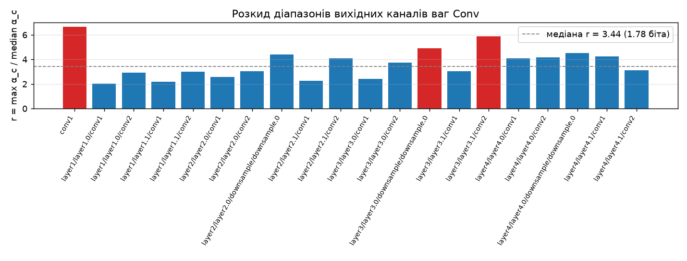
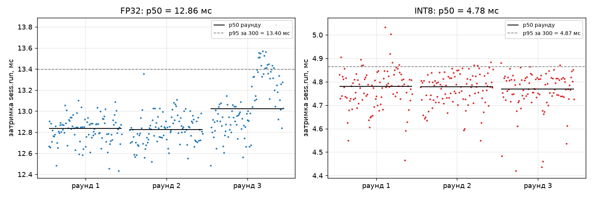

# ЛР4. FP32 проти INT8

**Автор:** Микитенко Юрій Андрійович, група КМ-32  
**Стек:** Python 3.12, PyTorch 2.8.0, torchvision 0.23.0, ONNX 1.23.2, ONNX Runtime 1.31.1, NumPy 2.4.4, scikit-learn 1.8.0, Pillow 13.0.0, Matplotlib 3.11.2. Усі вимірювання на CPU (Apple M4 Pro), 1 потік.

**Питання роботи.** Чи дає статична квантизація після навчання (post-training quantization) виграш у затримці на моєму CPU, і якою зміною якості та розміру файлу він купується?

**Коротка відповідь.** Так. INT8 має p50 4.78 мс проти 12.86 мс у FP32 (у 2.69 раза менше, зміну виміряно), файл менший у 3.96 раза (11.30 МБ проти 44.71 МБ). Якість не відрізняється від шуму: $\Delta_{\text{acc}} = +0.0007 \pm 0.0022$, згода з FP32 0.9920.

## 1. Відтворення

Модель і поділ беруться з ЛР3 (`../lab3/lab3_model.pt`, `../lab3/split.csv`). Набір: [Intel Image Classification (Kaggle, puneet6060/intel-image-classification)](https://www.kaggle.com/datasets/puneet6060/intel-image-classification). Параметр `--data` — тека розпакованого архіву, у якій лежать `seg_train/seg_train/<клас>/` і `seg_test/seg_test/<клас>/`. Набір і файли `.onnx` до репозиторію не додаються.

```bash
cd lab4
uv sync
```

```bash
uv run python lab4.py --model ../lab3/lab3_model.pt --split ../lab3/split.csv --data /шлях/до/archive
```

Одна команда виконує пункти 1–5 по черзі (≈ 2 хв на M4 Pro) і пише:

| Що | Де |
|---|---|
| Моделі | `lab4_fp32.onnx`, `lab4_fp32_prep.onnx` (після `quant_pre_process`), `lab4_int8.onnx`, `lab4_int8_per_tensor.onnx` |
| Усі числа пунктів 1–5, усі 300 вимірів затримки кожного варіанта, параметри середовища | `lab4_results.json` |
| Таблиці в markdown | `results/summary.md` |
| Логіти test ($1502 \times 6$) PyTorch, ONNX FP32, INT8, INT8 per-tensor | `results/test_logits_*.npy` |
| Графіки | `figures/channel_ranges.png`, `figures/latency.png` |

Якщо контроль поділу, калібрувальної вибірки або перевірка експорту не збігаються з очікуваним, команда зупиняється з повідомленням `ПОМИЛКА`. Опція `--ranges-only` виконує лише контроль, експорт і діапазони каналів (пункт 4). Саме з нею я отримав числа для прогнозу до побудови per-tensor моделі.

Усі числа цього звіту взято з `lab4_results.json` / `results/summary.md` останнього запуску (повний вивід — `run_log.txt`).

## 2. Структура

| Файл | Призначення |
|---|---|
| `common.py` | Константи й контрольні числа, читання поділу, калібрувальна вибірка, перетворення, завантаження моделі, сесії ONNX Runtime, метрики й парне порівняння, параметри середовища |
| `lab4.py` | Команда: контроль, експорт, квантизація, якість, діапазони каналів, затримка, запис результатів |
| `pyproject.toml`, `uv.lock`, `.python-version` | Залежності із зафіксованими версіями |
| `lab4_results.json` | Усі результати (структура нижче) |
| `results/summary.md`, `results/test_logits_*.npy` | Таблиці й логіти test |
| `figures/` | Діапазони каналів, виміри затримки |
| `ranges_log.txt` | Вивід `--ranges-only` (етап прогнозу) |
| `run_log.txt` | Повний вивід команди |

Розділи `lab4_results.json`: `environment`, `git`, `inputs`, `split_control`, `settings`, `calibration` (зокрема список 200 файлів), `timings_s`, `1_export_check`, `3_quality`, `4_per_tensor`, `5_latency` (зокрема `raw_ms` — 3 раунди × 100 вимірів для кожного варіанта), `5b_diagnostic_kleidiai_disabled`.

## 3. Дані, модель і фіксовані налаштування

**Модель.** `torch.load(path, map_location="cpu", weights_only=True)` → `resnet18(weights=None)` → `fc = Linear(512, 6)` → `load_state_dict` → `eval()`. У файлі: `regime = frozen`, `seed = 3`, `img_size = 160`, класи `buildings, forest, glacier, mountain, sea, street` — порядок збігається з ЛР3 (перевіряється в коді).

**Перетворення** для всіх зображень (калібрувальних і тестових) — як для test у ЛР3: `Resize((160, 160))` → `ToTensor()` → `Normalize(mean, std)`, $\text{mean} = (0.485,\ 0.456,\ 0.406)$, $\text{std} = (0.229,\ 0.224,\ 0.225)$; зображення відкриваються через `PIL.Image.open(...).convert("RGB")`. Порядок тестових зображень усюди — порядок рядків test у `split.csv`.

| Етап | Налаштування |
|---|---|
| Експорт | `torch.onnx.export(dynamo=False, opset_version=17)`, вхід `input`, вихід `logits`, `dynamic_axes` за віссю 0 для обох; модель в `eval()`; фіктивний вхід `zeros(1, 3, 160, 160)` |
| Підготовка | `quant_pre_process(fp32, prep, skip_symbolic_shape=True)` |
| Квантизація | `quantize_static(quant_format=QDQ, activation_type=QUInt8, weight_type=QInt8, per_channel=True, calibrate_method=MinMax)`, решта за замовчуванням; для досліду пункту 4 — те саме з `per_channel=False` |
| Сесія | `InferenceSession(providers=["CPUExecutionProvider"])`, `intra_op_num_threads=1`, `inter_op_num_threads=1`, рівень оптимізації графа за замовчуванням |
| Якість | усі 1502 зображення test, пакети по 64 |
| Затримка | пакет $B=1$, 1 потік, 3 раунди × (20 прогрівів + 100 вимірів) на варіант |

### Контроль поділу

| Частина | Кількість | Сума імен | Контроль |
|---|---|---|---|
| train | 1200 | 11 993 084 | ✓ |
| test | 1502 | 33 351 444 | ✓ |

SHA-256 `split.csv`: `d3a611aec41f6e335ab58287f10a443f3e0e35aa9adfefae662d48b15af567f9` — той самий, що в ЛР3. Validation у цій роботі не використовується.

## 4. Експорт і перевірка відповідності (пункт 1)

Логіти PyTorch (`torch.no_grad()`, пакети по 64) і сесії ONNX Runtime для всіх 1502 зображень test:

| Показник | Значення | Контроль |
|---|---|---|
| $\max\lvert z_{\text{ONNX}} - z_{\text{PyTorch}}\rvert$ | $4.58 \cdot 10^{-5}$ | порядок $10^{-5}$, $< 10^{-3}$ ✓ |
| Частка збігу передбаченого класу (argmax) | 1.0000 | 1.0000 ✓ |
| macro-F1 PyTorch | 0.8892 | = test у ЛР3 (0.8892) ✓ |
| macro-F1 ONNX FP32 | 0.8892 | = PyTorch ✓ |
| Вузлів `Conv` / `BatchNormalization` | 20 / 0 | 20 / 0 ✓ |

`BatchNormalization` у графі немає: в `eval()` BN — фіксоване афінне перетворення $y = \gamma\,(x-\hat\mu)/\sqrt{\hat\sigma^2+\varepsilon} + \beta$, і для моделі в `eval()` за `do_constant_folding=True` (значення за замовчуванням) експортер виконує прохід `_jit_pass_onnx_eval_peephole`, який зливає BN з попередньою згорткою:

$$
W' = W \cdot \frac{\gamma}{\sqrt{\hat\sigma^2+\varepsilon}}, \qquad
b' = \beta + (b - \hat\mu)\frac{\gamma}{\sqrt{\hat\sigma^2+\varepsilon}} .
$$

Різниця логітів $\sim 10^{-5}$ — це округлення `float32` (інший порядок підсумовування в ядрах PyTorch і ONNX Runtime та злиті BN). На передбачення вона не впливає.

## 5. Калібрування й квантизація (пункт 2)

**Калібрувальна вибірка** (`common.calibration_rows`): 1200 рядків `part == "train"`, відсортованих за іменем файлу як рядком; `idx = np.random.default_rng(0).permutation(1200)[:200]`.

| Показник | Значення | Контроль |
|---|---|---|
| Кількість | 200 | 200 ✓ |
| Сума числових імен | 1 921 470 | 1 921 470 ✓ |
| За класами | buildings 40, forest 35, glacier 36, mountain 33, sea 29, street 27 | ✓ |

Зображення подаються через `CalibrationDataReader` по одному ($1\times3\times160\times160$). Діапазони активацій, оцінені на калібруванні (MinMax), стають параметрами моделі (масштаб і нульова точка кожного `QuantizeLinear`), тому test для калібрування не використовується.

**Час** (окремо для кожного етапу, `time.perf_counter`):

| Етап | Час, с |
|---|---|
| Експорт `torch.onnx.export` → `lab4_fp32.onnx` | 0.13 |
| `quant_pre_process` | 0.08 |
| `quantize_static` per-channel (калібрування на 200 зображеннях + квантизація) → `lab4_int8.onnx` | 0.96 |
| `quantize_static` per-tensor → `lab4_int8_per_tensor.onnx` | 0.88 |

## 6. Якість (пункт 3)

Нехай $b$ — кількість зображень, на яких варіант правий, а FP32 помиляється, $c$ — навпаки. Якщо варіанти однаково точні, $b \sim \mathrm{Bin}(b+c,\ 1/2)$, звідки

$$
\Delta_{\text{acc}} = \text{acc}_{\text{INT8}} - \text{acc}_{\text{FP32}} = \frac{b-c}{n}, \qquad
\mathrm{SE}(\Delta_{\text{acc}}) \approx \frac{\sqrt{b+c}}{n}, \qquad n = 1502 .
$$

**Правило:** $|b-c| \le 2\sqrt{b+c}$ — різниця не відрізняється від шуму; $|b-c| > 2\sqrt{b+c}$ — відрізняється, і треба назвати напрям.

| Варіант | macro-F1 | accuracy | Згода з FP32 | $b$ | $c$ | $\Delta_{\text{acc}} \pm \mathrm{SE}$ | $\lvert b-c\rvert$ vs $2\sqrt{b+c}$ |
|---|---|---|---|---|---|---|---|
| FP32 | 0.8892 | 0.8862 (1331/1502) | 1 | 0 | 0 | — | — |
| INT8 | 0.8900 | 0.8868 (1332/1502) | 0.9920 | 6 | 5 | +0.0007 ± 0.0022 | 1 ≤ 6.63 |

**Вердикт:** $|b-c| = 1 \le 2\sqrt{11} = 6.63$ → **різниця якості INT8 і FP32 не відрізняється від шуму.** INT8 змінила передбачення на 12 зображеннях із 1502 (згода 0.9920): на 6 виправила помилку FP32, на 5 зробила нову, ще одне перейшло з однієї помилки в іншу.

**Парна похибка проти похибки однієї моделі.** Стандартна похибка accuracy однієї моделі (FP32, як у ЛР3):

$$
\sqrt{\frac{p(1-p)}{n}} = \sqrt{\frac{0.8862 \cdot 0.1138}{1502}} = 0.0082, \qquad
\mathrm{SE}(\Delta_{\text{acc}}) = \frac{\sqrt{11}}{1502} = 0.0022 ,
$$

тобто парна похибка менша в $0.0082 / 0.0022 \approx 3.7$ раза. Причина в тому, що обидві моделі оцінюються на **тих самих** зображеннях і помиляються майже на тих самих: $\mathrm{Var}(\text{acc}_A - \text{acc}_B) = \mathrm{Var}_A + \mathrm{Var}_B - 2\,\mathrm{Cov}_{AB}$, а за згоди 0.992 коваріація майже повністю компенсує дисперсії. Зображення, на яких обидві праві (1326) або обидві помиляються (165), у різницю нічого не вносять. Шум різниці визначають лише $b+c = 11$ розбіжних зображень, а не всі 1502. Похибка однієї моделі описує інше питання: наскільки 0.886 залежить від того, які саме 1502 зображення потрапили в test. Ця складова однакова для обох моделей і при парному порівнянні скорочується.

## 7. Дослід із потензорними вагами (пункт 4)

Per-channel квантизація бере для кожного вихідного каналу $c$ власний діапазон $\alpha_c = \max\lvert w\rvert$, per-tensor — один $\max_c \alpha_c$ на весь тензор. Крок квантизації пропорційний діапазону, тому каналу $c$ потензорний крок коштує $\log_2(\max_{c'}\alpha_{c'}/\alpha_c)$ біта.

### Діапазони каналів

Для кожного з 20 вузлів `Conv` графа `lab4_fp32.onnx` ваги беруться з `graph.initializer` (`numpy_helper.to_array`) за іменем другого входу вузла, форма $(C_{\text{out}}, C_{\text{in}}, k_H, k_W)$; $r = \max_c\alpha_c / \mathrm{median}_c\,\alpha_c$. Це ваги **після злиття BN**: множник $\gamma/\sqrt{\hat\sigma^2+\varepsilon}$ різний для кожного каналу, тому саме він сильно розводить діапазони.

| Згортка | $r$ | $\log_2 r$, біт |
|---|---|---|
| `/conv1/Conv` | **6.67** | 2.74 |
| `/layer3/layer3.1/conv2/Conv` | **5.90** | 2.56 |
| `/layer3/layer3.0/downsample/downsample.0/Conv` | **4.92** | 2.30 |
| Медіана за 20 згортками | **3.44** | **1.78** |

Медіанному каналу потензорний крок коштує $\log_2 3.44 = 1.78$ біта. Числа збігаються з еталонними: у режимі frozen усі згортки й BN кістяка лишилися вагами ImageNet (BN під час навчання був в `eval()`), а `fc` не є згорткою. Повна таблиця для всіх 20 згорток — у `results/summary.md`.



### Прогноз до запуску (записано після `--ranges-only`, до побудови `lab4_int8_per_tensor.onnx`)

Медіанне $r = 3.44$: при потензорному кроці медіанний вихідний канал втрачає $\log_2 3.44 \approx 1.78$ біта, тобто його ваги фактично квантуються ≈ 6.2 бітами замість 8. Найгірше `/conv1/Conv` ($r = 6.67$, 2.74 біта → ≈ 5.3 біта) і `/layer3/layer3.1/conv2/Conv` ($r = 5.90$, 2.56 біта). Це в рази менше, ніж у першій згортці MobileNetV3 ($r \approx 90$, ≈ 6.5 біта втрати), тож катастрофи не очікую.

1. **Згода з FP32 впаде** порівняно з per-channel INT8: грубіший крок у кожному шарі додає шум до логітів, і зображень біля межі класів, де argmax перемикається, стане більше. Очікую згоду ≈ 0.97–0.99 (нижчу, ніж у per-channel).
2. **macro-F1 не зміниться понад шум** за правилом пункту 3: перемикання argmax відбуваються на неоднозначних зображеннях в обидва боки (частина помилок FP32 стане правильною, частина правильних — помилками), тому $b$ і $c$ зростуть разом, а $|b-c|$ лишиться в межах $2\sqrt{b+c}$.

### Результат

`lab4_int8_per_tensor.onnx`: та сама калібрувальна вибірка й ті самі параметри, лише `per_channel=False`.

| Варіант | macro-F1 | accuracy | Згода з FP32 | $b$ | $c$ | $\Delta_{\text{acc}} \pm \mathrm{SE}$ | $\lvert b-c\rvert$ vs $2\sqrt{b+c}$ |
|---|---|---|---|---|---|---|---|
| FP32 | 0.8892 | 0.8862 | 1 | 0 | 0 | — | — |
| INT8 per-channel | 0.8900 | 0.8868 | 0.9920 | 6 | 5 | +0.0007 ± 0.0022 | 1 ≤ 6.63 |
| INT8 per-tensor | 0.8925 | 0.8895 | 0.9800 | 17 | 12 | +0.0033 ± 0.0036 | 5 ≤ 10.77 |

**Зіставлення з прогнозом — обидва пункти справдилися.**

1. Згода впала з 0.9920 до 0.9800: розбіжних передбачень 30 замість 12, тобто в 2.5 раза більше. Це в межах прогнозованих 0.97–0.99.
2. $|b-c| = 5 \le 2\sqrt{29} = 10.77$ → різниця якості з FP32 **не відрізняється від шуму**. macro-F1 навіть формально вищий (0.8925), але це той самий шум: $\Delta_{\text{acc}} = +0.0033$ менше за 1 SE (0.0036).

**Чому згода чутливіша за macro-F1.** Згода рахує **кожне** перемикання argmax: $1 - \text{згода} = (b + c + e)/n$, де $e$ — перемикання між двома неправильними класами (тут $e = 1$). Accuracy і macro-F1 бачать лише **чистий** ефект $b - c$. Квантизація додає до логітів малий шум, і він перемикає клас тільки там, де FP32 вагається між двома класами, тобто на неоднозначних зображеннях (glacier ↔ mountain, street ↔ buildings у ЛР3). На таких зображеннях FP32 приблизно однаково часто правий і неправий, тож перемикання в бік правильної відповіді ($b$) і в бік помилки ($c$) майже рівноймовірні. Вони **взаємно компенсуються** в $b - c$: тут $b+c$ зросло з 11 до 29, а $b - c$ змінилося лише з 1 до 5. Тому згода — ранній і чутливий індикатор того, що квантизація змінила функцію моделі, тоді як macro-F1 може показувати «без змін» або навіть «покращення» в межах шуму.

## 8. Затримка (пункт 5)

**Протокол** (`lab4.latency`):

1. Обидві сесії (`lab4_fp32.onnx`, `lab4_int8.onnx`) створюються заздалегідь; створення сесій, експорт і квантизація в час не входять.
2. Вхід один і той самий — перше зображення test у порядку `split.csv` (`20060.jpg`), масив `float32` форми $1\times3\times160\times160$, підготовлений до вимірювання (`np.ascontiguousarray`); словник входу створюється до циклу.
3. Три раунди. У кожному спершу FP32, потім INT8; для кожного варіанта 20 прогрівальних викликів без запису, потім 100 вимірів.
4. Вимір — один виклик `sess.run` між двома зчитуваннями `time.perf_counter()`, і нічого більше (запис у список — після другого зчитування).
5. p50 і p95 — за всіма 300 вимірами варіанта (`np.percentile`, лінійна інтерполяція); окремо p50 кожного раунду.

Під час вимірювання важкі програми закриті, Low Power Mode вимкнено (`pmset`: `powermode 0`). Ноутбук працював **від батареї** (`Battery Power`), а не від мережі, як вимагає умова. Це відхилення описано в розділі 10. Обидва значення записано в `lab4_results.json`.

| Варіант | Файл, МБ | p50, мс | p95, мс | p50 за раундами, мс |
|---|---|---|---|---|
| FP32 | 44.71 | 12.86 | 13.40 | 12.84 / 12.83 / 13.02 |
| INT8 | 11.30 | 4.78 | 4.87 | 4.78 / 4.78 / 4.77 |

Розмір файлу — кількість байтів, поділена на $10^6$ (44 708 865 і 11 297 049 байтів). Прискорення $p50_{\text{FP32}} / p50_{\text{INT8}} = 12.86 / 4.78 = $ **2.69**; за p95 — 2.75.

**Правило інтерпретації:** відрізки p50 за раундами — FP32 $[12.83,\ 13.02]$, INT8 $[4.77,\ 4.78]$ — **не перетинаються** → **зміну затримки виміряно.** Розкид p50 між раундами (≤ 0.20 мс) у ≈ 40 разів менший за різницю між варіантами (8.09 мс).



### Параметри середовища

| Параметр | Значення |
|---|---|
| Процесор | Apple M4 Pro (10 продуктивних + 4 енергоефективні ядра, 14 логічних); `FEAT_DotProd`, `FEAT_I8MM`, `FEAT_SME`, `FEAT_SME2` = так |
| ОС | macOS 27.2 (arm64) |
| Python / PyTorch / ONNX / ONNX Runtime | 3.12.10 / 2.8.0 / 1.23.2 / 1.31.1 |
| Провайдер | `CPUExecutionProvider` |
| Потоків | 1 (`intra_op_num_threads = inter_op_num_threads = 1`) |
| Розмір пакета | 1 (затримка), 64 (якість) |
| Живлення | від батареї (відхилення, розділ 10), Low Power Mode вимкнено |

### Діагностика: чому FP32 тут такий швидкий (поза протоколом)

Орієнтир завдання на M3 Pro: FP32 21.91 мс, INT8 5.60 мс, прискорення 3.91. У мене INT8 близька до орієнтиру (4.78 мс), а FP32 майже вдвічі швидший (12.86 мс). ONNX Runtime 1.31.1 для arm64 містить ядра Arm KleidiAI у бібліотеці MLAS і має ключ сесії `mlas.disable_kleidiai`. Після основного протоколу команда повторює **той самий** протокол (ті самі файли, вхід, 3 × (20 + 100)) із `mlas.disable_kleidiai=1`:

| Конфігурація MLAS | FP32 p50, мс | INT8 p50, мс | Прискорення p50 |
|---|---|---|---|
| за замовчуванням (KleidiAI увімкнено) — основний протокол | 12.86 | 4.78 | 2.69 |
| `mlas.disable_kleidiai=1` — діагностика | 20.10 | 4.78 | 4.21 |

Без KleidiAI FP32 сповільнюється в 1.56 раза, а INT8 не змінюється (4.78 мс в обох випадках). Отже, KleidiAI на цій версії ONNX Runtime прискорює саме FP32-згортки, а цілочисельні йдуть власними ядрами MLAS. Без KleidiAI прискорення INT8 (4.21) близьке до орієнтиру M3 Pro (3.91). Те, що KleidiAI тут використовує саме матричне розширення SME (у M3 його немає, у M4 є), — моє припущення: прапорець SME я бачу, але вибір конкретного мікроядра всередині MLAS не перевіряв. Діагностика не замінює протокол пункту 5: усі висновки нижче спираються на основну таблицю.

## 9. Висновок

Висновок стосується **Apple M4 Pro** і **ONNX Runtime 1.31.1** (1 потік, $B = 1$).

**Ресурси.** Розмір файлу зменшився в **3.96 раза** (44.71 → 11.30 МБ), p50 — у **2.69 раза** (12.86 → 4.78 мс), p95 — у **2.75 раза** (13.40 → 4.87 мс). Відрізки p50 за раундами $[12.83,\ 13.02]$ і $[4.77,\ 4.78]$ не перетинаються, тому **зміну затримки виміряно** за правилом пункту 5. Розмір не зменшився рівно вчетверо, бо зсуви (bias) у QDQ-графі зберігаються як `int32` (4 байти, як і `float32`; 21 зсув — 20 згорток і `fc`), а до файлу додаються масштаби й нульові точки кожного каналу та 108 вузлів `QuantizeLinear`/`DequantizeLinear`.

**Якість.** $|b-c| = |6-5| = 1 \le 2\sqrt{11} = 6.63$: зміна якості **не відрізняється від шуму**, $\Delta_{\text{acc}} = +0.0007 \pm 0.0022$, macro-F1 0.8900 проти 0.8892. Згода передбачень із FP32 — **0.9920** (12 розбіжностей із 1502).

**Чому прискорення 2.69, а не 4.** Чотирикратне зменшення байтів ваг дало б чотирикратне прискорення лише тоді, коли час визначається читанням пам'яті. За моделлю даху (лекція 9) це не наш випадок:

- Одна інференція ResNet-18 на $160\times160$ — $0.925 \cdot 10^9$ MAC $= 1.85$ GFLOP (пораховано за формами згорток графа). Ваг FP32 — 44.7 МБ, тож арифметична інтенсивність лише за вагами $\approx 1.85 \cdot 10^9 / 44.7 \cdot 10^6 \approx 41$ FLOP/байт, а для INT8 (11.2 МБ ваг) $\approx 166$ оп/байт. Навіть якщо всі ваги читати з DRAM на кожному виклику, FP32 потребує лише $44.7\ \text{МБ} / 12.86\ \text{мс} \approx 3.5$ ГБ/с. Це на два порядки менше за пропускну здатність пам'яті M4 Pro (за специфікацією Apple 273 ГБ/с на весь чип; точної межі для одного ядра я не вимірював). Модель лежить **праворуч від точки перегину** — в обчислювальній області даху.
- В обчислювальній області прискорення дорівнює відношенню досягнутої обчислювальної продуктивності ядер, а не відношенню байтів: FP32 досягає $1.85 / 12.86\ \text{мс} \approx 144$ GFLOP/с, INT8 — $1.85 / 4.78\ \text{мс} \approx 387$ Гоп/с. Звідси 2.69.
- **Цілочисельні ядра для INT8 у цього CPU є:** `FEAT_DotProd` (SDOT/UDOT — 4 множення-додавання `int8` у кожній 32-бітній смузі) і `FEAT_I8MM` (SMMLA/USMMLA — матричне $2\times8 \cdot 8\times2$). Тому INT8 приблизно у 2.7 раза швидша за FP32 навіть попри накладні витрати на `QuantizeLinear`/`DequantizeLinear` активацій і перемасштабування між шарами.
- Прискорення менше, ніж 3.91 на M3 Pro, не через повільну INT8 (4.78 мс проти 5.60 мс в орієнтирі), а через дуже швидкий FP32: діагностика показує, що ядра KleidiAI прискорюють FP32 у 1.56 раза. Без них прискорення було б 4.21. Отже, чим краще процесор і бібліотека оптимізують FP32, тим менший відносний виграш від INT8. Саме тому прискорення INT8 залежить від процесора (і від версії ONNX Runtime).

**Придатність.** На цьому ноутбуці INT8-модель **придатна** для задачі: якість у межах шуму (згода 0.992, $\Delta_{\text{acc}}$ у межах 1 SE), файл учетверо менший, а p50 4.78 мс на одному потоці (≈ 209 зображень/с) у 2.7 раза краща за FP32 зі стабільним хвостом (p95 4.87 мс).

## 10. Відхилення, коміти, джерела

- **Відхилень від фіксованих налаштувань (таблиця умови) немає.** Версії бібліотек зафіксовано в `pyproject.toml`/`uv.lock` і записано в `lab4_results.json`. Те, що умова не фіксує, я вибрав так: фіктивний вхід для експорту — `zeros(1, 3, 160, 160)` (на граф не впливає); логіти PyTorch рахуються з кількістю потоків PyTorch за замовчуванням (вона впливає лише на молодші розряди різниці логітів).
- **Додатково до протоколу:** діагностичний замір із `mlas.disable_kleidiai=1` (розділ 8). Він виконується **після** основного протоколу в окремих сесіях і на основну таблицю не впливає.
- **Відхилення від протоколу пункту 5: живлення.** Остаточний запуск, з якого взято всі числа звіту, виконано від батареї (Low Power Mode вимкнено, `powermode 0`), а не від мережі. Попередній запуск тієї самої команди від мережі дав FP32 p50 12.79 мс, INT8 4.73 мс і прискорення 2.70. Різниця з наведеними числами менша за 1 %, вердикт пункту 5 і висновок не змінюються.
- **Етапи запуску.** Спершу `--ranges-only` (вивід — `ranges_log.txt`), після нього записано прогноз розділу 7, і лише потім виконано повну команду. Прогноз після запуску не змінювався. Якість і контрольні числа однакові в усіх запусках.
- **Коміт коду.** `lab4_results.json` записано з `git.commit = cc95e9c` (останній коміт із ЛР3) і `uncommitted_changes = true`, бо код ЛР4 на момент запуску ще не був закомічений.
- Файли `.onnx`, набір даних і умова (PDF) до репозиторію не додаються (`.gitignore`). Модель береться з `lab3/lab3_model.pt`.
- Джерела: документація PyTorch (`torch.onnx.export`), ONNX (`onnx.numpy_helper`, оператори `Conv`, `QuantizeLinear`/`DequantizeLinear`), ONNX Runtime (`quantize_static`, `quant_pre_process`, `CalibrationDataReader`, `SessionOptions`, конфігурація MLAS `mlas.disable_kleidiai`), scikit-learn (`f1_score`, `accuracy_score`), Arm KleidiAI.
- Під час виконання використано генеративний інструмент Claude (Anthropic) для підготовки коду й тексту звіту. Код, контрольні числа, формули й висновки автор перевірив і пояснює самостійно.
